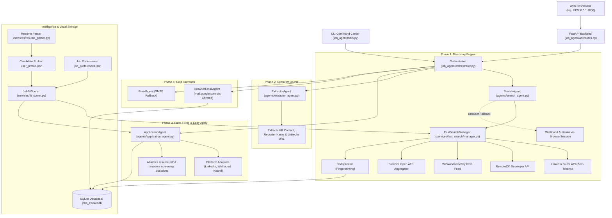

# AutoApply: Autonomous AI Recruitment & Application Agent

AutoApply is a production-grade autonomous job hunting, qualification, multi-step application autofilling, recruiter extraction, and outreach system powered by Python 3.11+, `browser-use`, Playwright, Click, Rich, and SQLite.

This skill equips coding agents (Antigravity, Claude Code, Cursor, Windsurf, Devin, Copilot Workspace, Roo Code) to safely configure, operate, debug, search, qualify, and execute autonomous job campaigns on behalf of the user.

---

## 1. System Architecture & The 4-Phase Pipeline



### The 4 Execution Phases:
1. **Phase 1: Discovery & Recency Filtering**
   - **Default Fast-Path**: Zero-token, unauthenticated HTTP APIs and feeds (`LinkedIn Guest`, `RemoteOK`, `WeWorkRemotely`, `Freehire ATS`). Runs concurrently in ~2.5 seconds.
   - **Recency Filtering**: Filter vacancies by publication date (`1d`, `7d`, `14d`, `30d`, or any time).
   - **Browser Fallback**: Persistent headful/headless Chrome for login-gated portals (`Wellfound`, `Naukri`).
2. **Phase 2: Recruiter OSINT Extraction**
   - [`ExtractorAgent`](file:///D:/js/autoapply/job_agent/agents/extractor_agent.py) inspects company profiles and job posts to retrieve recruiter names, direct emails, and LinkedIn profile URLs.
3. **Phase 3: Autonomous Form Filling**
   - [`ApplicationAgent`](file:///D:/js/autoapply/job_agent/agents/application_agent.py) attaches `resume.pdf`, solves dynamic screening questions using candidate data, and generates 3-4 sentence tailored cover letter pitches.
4. **Phase 4: Stealth Browser Outreach**
   - [`BrowserEmailAgent`](file:///D:/js/autoapply/job_agent/agents/browser_email_agent.py) opens webmail (`mail.google.com`) directly inside the authenticated Chrome session to draft and dispatch personalized outreach without requiring third-party SMTP or App Passwords.

---

## 2. Mandatory Agent Safety & Privacy Guardrails

> [!IMPORTANT]
> ### 1. Explicit Git Commit & Push Rule
> **NEVER execute `git commit` or `git push` on your own initiative.**
> All code edits, refactors, and test additions must remain uncommitted in the local working directory until the user specifically instructs: *"commit and push"* or gives explicit written approval.

> [!CAUTION]
> ### 2. Strict Candidate Privacy Protection
> **NEVER stage, commit, print, or leak candidate personal data**:
> - `job_agent/data/resume.pdf` and `job_agent/data/resume.txt`
> - `job_agent/data/user_profile.json` and `job_agent/data/job_preferences.json`
> - `job_agent/data/*.db` (SQLite tracker)
> - `.env` or any file containing API keys or user credentials.
> Always run `git status` prior to committing to ensure only source code and test files are staged.

### 3. Execution Safety Modes:
- **Ask Mode (`--mode ask`, Default)**: When running applications or email outreach, the agent **pauses and prompts the user in the terminal** (`request_human_confirmation`) before clicking final submit or sending an email.
- **Dry-Run Mode (`--dry-run`)**: Fills out every form field and step on-screen, stops immediately before the final submit button, and logs `status='applied'` with dry-run notes. **Always recommend this first**.
- **Free Mode (`--mode free`)**: Full autopilot mode without interactive human pauses. Only execute when explicitly requested with `--free` or `--mode free`.

---

## 3. Candidate Qualification & Hard Gates

All discovered jobs pass through [`JobFitScorer.score_fit`](file:///D:/js/autoapply/job_agent/services/fit_scorer.py):
- **Fit Score Weighting**: Skills Match (**45%**), Job Title Relevance (**30%**), Experience Match (**25%**), with Location penalties.
- **Hard Junior Gate**: If candidate experience $\le 1.0$ year and the job specifies $2+$ years, match score drops to **`0.0%`**.
- **Hard Seniority Gate**: Roles titled `Senior`, `Lead`, `Staff`, `Principal`, `Director`, `Head of`, or `VP` are forced to **`0.0%`** if candidate experience is $< 2.5$ years.
- **Experience Gap Gate**: Any role with a requirement gap $\ge 2.0$ years above candidate experience is automatically rejected (**`0.0%`**).

---

## 4. Environment Diagnostics & Setup

Before executing job searches or autonomous applications, verify system readiness:

```bash
# Check Chrome binaries, LLM connectivity, lock files, database, and candidate profile
uv run autoapply doctor

# Validate active profile, calculated experience, and search preferences
uv run autoapply config check

# Display parsed candidate profile and skills
uv run autoapply profile show

# Interactive setup wizard / auto-parse resume
uv run autoapply setup --resume job_agent/data/resume.pdf --auto
```

### Manual Platform Authentication (One-Time Setup):
To log into login-gated portals (`LinkedIn`, `Wellfound`, `Naukri`, `Gmail`):
```bash
# Opens persistent headful Chrome so the user can log in and persist cookies:
uv run autoapply auth --platform all --manual
```

---

## 5. Command Reference & Autonomous Workflows

### Workflow A: Zero-Token Multi-Platform Fast Search (Recommended)
High-speed discovery across LinkedIn Guest, RemoteOK, WeWorkRemotely, and tech ATS boards in parallel:

```bash
# Search across all fast platforms concurrently (LinkedIn, RemoteOK, WWR, ATS):
uv run autoapply search --platforms all --roles "AI Engineer, Software Engineer" --limit 25 --min-fit 50

# Filter by posting recency (e.g. past 7 days, past 24 hours, past 14 days):
uv run autoapply search --platforms all --posted-within 7 --min-fit 45
uv run autoapply search --platforms linkedin --days 1 --easy-apply-only

# Target remote developer boards with disclosed compensation:
uv run autoapply search --platforms remoteok,wwr --roles "Full Stack Engineer" --limit 30

# Filter exclusively for 1-click Easy Apply roles:
uv run autoapply search --platforms linkedin --easy-apply-only --min-fit 50

# Deep browser search for login-gated portals (Wellfound, Naukri):
uv run autoapply search --browser --platforms wellfound,naukri
```

### Workflow B: Safe Application Form Filling (Dry-Run Preview)
Autofills multi-step forms on screen, attaches `resume.pdf`, and answers screening questions:

```bash
# Safe dry-run preview (fills forms on screen, stops right before final submission):
uv run autoapply apply --dry-run --limit 3

# Live application submission (submits forms directly):
uv run autoapply apply --live --limit 5
```

### Workflow C: End-to-End Autonomous Pipeline (`auto`)
Executes the unified 4-phase recruitment lifecycle:
**Phase 1: Search** $\to$ **Phase 2: Recruiter Extraction** $\to$ **Phase 3: Best-Fit Applications** $\to$ **Phase 4: Cold Outreach**

```bash
# Interactive Ask Mode (Terminal pauses for human confirmation before each submit/email):
uv run autoapply auto --mode ask --max-apply 5

# Safe dry-run pipeline:
uv run autoapply auto --mode ask --dry-run --max-apply 3

# Full autopilot mode (100% autonomous, no terminal pauses):
uv run autoapply auto --mode free --max-apply 5

# Filter by platform and minimum match score:
uv run autoapply auto --platforms remoteok,wwr --roles "Python Developer" --min-fit 55 --mode ask
```

### Workflow D: Recruiter Intelligence & Cold Email Outreach
```bash
# Phase 2: Hunt for recruiter names, emails, and LinkedIn URLs for discovered jobs:
uv run autoapply extract --limit 10

# Phase 4: Dispatch cold emails via browser Gmail (Zero SMTP setup required):
uv run autoapply email --limit 5

# Generate tailored 3-4 sentence cover letter pitch for a specific job:
uv run autoapply pitch <job_id>
```

### Workflow E: Web Mission Control Dashboard & REST API
AutoApply includes a single-page Vue 3 + Tailwind CSS dashboard designed with a clean **shadcn warm beige** aesthetic (`http://127.0.0.1:8000`):

```bash
# Launch interactive web dashboard & background runner:
uv run autoapply ui
# Or aliases:
uv run autoapply web
uv run autoapply dashboard
```

- **Features**: Real-time funnel metrics, multi-platform job discovery with Date Posted filter, in-memory paginated Application Tracker (10/15/25/50 per page) with instant text search, candidate profile editor, and background autopilot runner with live log streaming.
- **REST API Docs**: Open interactive OpenAPI documentation at `http://127.0.0.1:8000/docs`.

---

## 6. Database Inspection & Application Tracking

All discovered jobs, application statuses, recruiter contacts, and scheduled interviews are tracked locally in `job_agent/data/jobs_tracker.db`.

```bash
# View funnel statistics (found, applied, interviews, outreach):
uv run autoapply stats

# List discovered jobs with pagination and platform filters:
uv run autoapply jobs --limit 20
uv run autoapply jobs --platform linkedin --limit 15

# Inspect full details, required skills, and qualification notes for a job:
uv run autoapply job show <job_id>

# Update job status manually (found, applied, interview, rejected, offer):
uv run autoapply job update <job_id> --status applied

# Delete an unwanted job record:
uv run autoapply job delete <job_id>

# Purge low-scoring jobs below threshold:
uv run autoapply clean --min-fit 45.0 -y

# Export all application records and HR contacts to CSV:
uv run autoapply export --output applications.csv

# Log an interview invitation:
uv run autoapply interview log --job-id <id> --company "Acme Corp" --role "AI Engineer" --date "2026-11-10 14:00" --meeting-link "https://meet.google.com/xyz"

# List all scheduled interviews:
uv run autoapply interview list
```

---

## 7. REST API Endpoints Reference

When interacting via HTTP or building custom frontends:

| Method | Endpoint | Description |
| :--- | :--- | :--- |
| `GET` | `/api/stats` | Aggregated funnel metrics and platform breakdown |
| `GET` | `/api/jobs` | Retrieve cataloged jobs (supports `limit`, `offset`, `search`, `status`, `platform`) |
| `GET` | `/api/jobs/paged` | Paginated jobs payload (`items`, `total`, `page`, `page_size`, `total_pages`) |
| `PATCH`| `/api/jobs/{id}/status` | Update vacancy status (`found`, `applied`, `interview`, `rejected`, `offer`) |
| `POST` | `/api/jobs/{id}/pitch` | Generate tailored 3-4 sentence cover letter pitch via LLM |
| `DELETE`| `/api/jobs/{id}` | Remove job record from SQLite tracker |
| `POST` | `/api/search` | Trigger concurrent discovery (`roles`, `locations`, `platforms`, `time_posted_days`, `min_fit_score`) |
| `POST` | `/api/runner/apply` | Launch background application runner task |
| `POST` | `/api/runner/auto` | Launch background 4-phase autonomous pipeline |
| `POST` | `/api/runner/stop` | Send graceful cancellation signal to background runner |
| `GET` | `/api/runner/status` | Current runner task status and recent log buffer |
| `GET` | `/api/profile` | Retrieve candidate profile and preferences |
| `PUT` | `/api/profile` | Update candidate profile, skills, and configuration |

---

## 8. Troubleshooting & Agent Runbook Edge Cases

- **Chrome Profile Lock Error (`SingletonLock`)**:
  If Chrome fails to start because of an unreleased lock file from a previous session, run `uv run autoapply doctor`. AutoApply automatically executes `clean_profile_locks()` to purge stale locks.
- **Port 8000 Conflict**:
  If `autoapply ui` reports port 8000 in use, locate the running process using `Get-Process` or run with a custom port: `uv run autoapply ui --port 8080`.
- **Anti-Bot & Rate-Limiting Protections**:
  AutoApply enforces human-paced randomized delays ($8 - 18\text{s}$) between browser actions and requests. Never remove or bypass these delays when modifying platform adapters.
- **Running Automated Test Suite**:
  Always verify 100% test passage after code edits:
  ```bash
  uv run pytest
  ```
