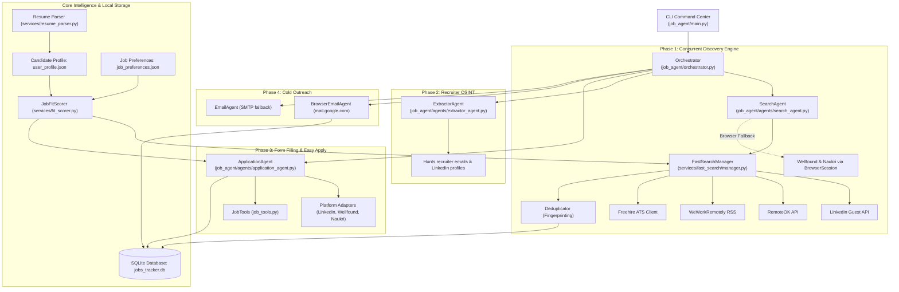

# AGENTS.md: AI Agent Operational Runbook

Welcome to **AutoApply**. This document outlines the architectural blueprints, development standards, operational workflows, and security guardrails for autonomous coding agents (Antigravity, Claude, Cursor, Copilot, Windsurf, Devin, etc.) operating within this repository.

---

## 1. Repository Identity & Core Purpose

- **Name**: AutoApply
- **Package Name**: `autoapply` (CLI commands: `autoapply` and `job-agent`)
- **Language & Runtime**: Python `>=3.11, <3.14`
- **Package Manager**: `uv` (Astral)
- **Primary Frameworks**: `browser-use` (>=0.13.11), Playwright, Click, Rich, Pydantic v2, SQLite3
- **Mission**: Automate the entire job search, qualification, multi-step application form autofilling, recruiter extraction, and cold outreach lifecycle across LinkedIn, RemoteOK, WeWorkRemotely, Wellfound, Naukri, and tech ATS platforms.

---

## 2. System Architecture



---

## 3. The 4-Phase Autonomous Pipeline

1. **Phase 1: Discovery & Search**
   - **Default (Fast-Path)**: Zero-token, unauthenticated HTTP APIs and feeds (`LinkedIn Guest`, `RemoteOK`, `WeWorkRemotely`, `Freehire ATS`). Runs concurrently with `ThreadPoolExecutor` in ~2.5 seconds.
   - **Browser Fallback**: Launched for login-gated portals (`Wellfound`, `Naukri`) using persistent Chrome sessions.
2. **Phase 2: Recruiter OSINT Extraction**
   - [`ExtractorAgent`](file:///D:/js/autoapply/job_agent/agents/extractor_agent.py) inspects job posts and company profiles to identify HR contacts, emails, and LinkedIn URLs.
3. **Phase 3: Autonomous Form Filling**
   - [`ApplicationAgent`](file:///D:/js/autoapply/job_agent/agents/application_agent.py) attaches `job_agent/data/resume.pdf`, solves screening questions using [`UserProfile`](file:///D:/js/autoapply/job_agent/config.py), and generates tailored cover letter pitches.
4. **Phase 4: Cold Outreach**
   - [`BrowserEmailAgent`](file:///D:/js/autoapply/job_agent/agents/browser_email_agent.py) opens Gmail directly in the authenticated Chrome instance (`mail.google.com`) to send outreach without SMTP configuration.

---

## 4. Strict Safety & Candidate Privacy Rules (MUST FOLLOW)

> [!CAUTION]
> **Strict Privacy Guardrail**: NEVER commit, stage, or log candidate personal data:
> - `job_agent/data/resume.pdf` and `job_agent/data/resume.txt`
> - `job_agent/data/user_profile.json` and `job_agent/data/job_preferences.json`
> - `job_agent/data/*.db` (SQLite tracker)
> - `.env` or any file containing API keys or user credentials.
> Always verify with `git status` that only source code and tests are staged.

### Safety Modes:
- **Ask Mode (`--mode ask`, Default)**: When executing applications or outreach, agents **must pause** and prompt the user in terminal via `request_human_confirmation` before final submission or email sending.
- **Free Mode (`--mode free`)**: Autopilot mode. Only enabled when explicitly requested with `--free` or `--mode free`.
- **Dry-Run (`--dry-run`)**: Fills out every form step on screen, stops immediately prior to clicking the final submit button, and logs `status='applied'` with dry-run notes.

---

## 5. Candidate Qualification & Hard Gates

All discovered jobs pass through [`JobFitScorer.score_fit`](file:///D:/js/autoapply/job_agent/services/fit_scorer.py):
- **Weighting**: Skills (45%), Job Title (30%), Experience (25%), Location penalty.
- **Hard Junior Gate**: If candidate experience $\le 1.0$ year and the job specifies $2+$ years, match score drops to **`0.0%`**.
- **Hard Seniority Gate**: Roles titled `Senior`, `Lead`, `Staff`, `Principal`, `Director`, `Head of`, or `VP` are forced to **`0.0%`** if candidate experience is $< 2.5$ years.
- **Experience Gap Gate**: Any role with a requirement gap $\ge 2.0$ years above candidate experience is automatically rejected (**`0.0%`**).

---

## 6. Directory Map & Component Reference

```
job_agent/
├── main.py                     # Click CLI runner (~18 commands)
├── orchestrator.py             # Multi-agent pipeline controller
├── config.py                   # Pydantic v2 data models & JSON storage
├── database.py                 # SQLite JobTracker engine (jobs_tracker.db)
├── api/                        # REST API backend & Web Mission Control Dashboard
│   ├── app.py                  # FastAPI application & static mount
│   ├── routes.py               # REST endpoints (/api/jobs, /api/search, /api/runner)
│   ├── state.py                # Async background runner state & log buffer
│   └── static/index.html       # Single-page Vue 3 + Tailwind CSS dashboard
├── agents/
│   ├── search_agent.py         # Search coordinator (fast-path + browser fallback)
│   ├── application_agent.py    # Form autofill and resume attachment agent
│   ├── extractor_agent.py      # Recruiter contact scraper
│   ├── browser_email_agent.py  # Stealth browser Gmail webmail dispatcher
│   └── email_agent.py          # SMTP cold outreach dispatcher
├── services/
│   ├── fast_search/
│   │   ├── manager.py          # Parallel concurrent discovery engine
│   │   ├── deduplicator.py     # Canonical fingerprinting & salary extraction
│   │   ├── linkedin_guest.py   # Unauthenticated LinkedIn guest endpoint scraper
│   │   ├── remoteok_provider.py# RemoteOK public developer API provider
│   │   ├── wwr_provider.py     # WeWorkRemotely RSS category provider
│   │   ├── freehire_client.py  # Freehire open ATS aggregator client
│   │   └── models.py           # DiscoveredJob schemas & DB converters
│   ├── fit_scorer.py           # Seniority and experience hard gates
│   └── resume_parser.py        # Date-based fractional experience calculator
├── platforms/
│   ├── base.py                 # Abstract PlatformAdapter interface
│   ├── linkedin.py             # LinkedIn Easy Apply logic
│   ├── wellfound.py            # Wellfound startup job logic
│   └── naukri.py               # Naukri job application logic
├── tools/
│   ├── job_tools.py            # Custom browser-use actions (save_job, mark_applied, confirmation)
│   └── email_tools.py          # Email drafting and verification actions
└── data/                       # Local gitignored directory (user profile, db, resume)
```

---

## 7. Developer & Agent Commands

### Environment Setup
```bash
# Install all dependencies and setup environment
uv sync
```

### Running Verification Tests
```bash
# Run complete test suite (must always pass 100%)
uv run pytest

# Run fast-search tests specifically
uv run pytest tests/test_fast_search.py -v
```

### System Diagnostics
```bash
# Check Chrome binaries, lock files, database, and candidate profile
uv run autoapply doctor

# Validate active profile and preferences
uv run autoapply config check
```

### Job Search Workflows
```bash
# Concurrent search across all providers (LinkedIn, RemoteOK, WWR, ATS):
uv run autoapply search --platforms all --roles "AI Engineer, Software Engineer" --limit 20

# Filter exclusively for 1-click Easy Apply:
uv run autoapply search --platforms linkedin --easy-apply-only --min-fit 50

# Target remote developer boards with disclosed compensation:
uv run autoapply search --platforms remoteok,wwr --min-fit 40
```

### Autonomous Applications & Outreach
```bash
# Safe dry-run preview (fills forms on-screen, stops before submit):
uv run autoapply apply --dry-run --limit 3

# End-to-end autonomous pipeline (Ask Mode with terminal prompts):
uv run autoapply auto --mode ask --max-apply 5

# End-to-end autonomous pipeline (Free Mode autopilot):
uv run autoapply auto --mode free --max-apply 5
```

### Web Dashboard & REST API
```bash
# Launch interactive web dashboard & background runner (http://127.0.0.1:8000):
uv run autoapply ui
# Or aliases:
uv run autoapply web
uv run autoapply dashboard
```

---

## 8. Coding Standards & Git Conventions

- **Python Version**: Write Python 3.11+ code with `from __future__ import annotations`.
- **Type Annotations**: Mandatory for all function signatures and data schemas.
- **Formatting & Linting**: Line length 120, format using `uv run ruff check`.
- **Git Commits**: Follow Conventional Commits format:
  - `feat(<scope>): <description>`
  - `fix(<scope>): <description>`
  - `docs(<scope>): <description>`
  - `test(<scope>): <description>`
  - `refactor(<scope>): <description>`
